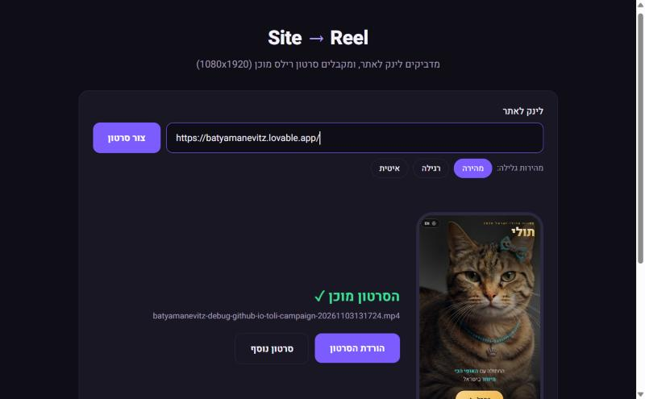

<div dir="rtl">

# Site → Reel · אתר לסרטון

**מדביקים לינק לאתר ומקבלים סרטון רילס מוכן (1080x1920).**

כלי שבניתי כדי לחסוך הקלטות מסך ידניות. הקלטה ידנית של אתר בטלפון יוצאת קופצנית, באיכות נמוכה ועם התראות. הכלי פותח את האתר בגודל מסך של טלפון, מקליט גלילה חלקה מלמעלה עד הסוף, וממיר את ההקלטה ל-MP4 אנכי שמוכן ל-CapCut, לרילס ולסטורי.

<p align="center">
  
  &nbsp;&nbsp;
  
</p>

## מה הוא עושה
1. פותח את האתר בגודל מסך של טלפון וסוגר באנר עוגיות אם יש
2. מקליט גלילה חלקה ואחידה. יש 3 מהירויות לבחירה
3. ממיר ל-MP4 אנכי, 1080x1920, 30fps
4. מציג תצוגה מקדימה בתוך מסגרת של טלפון וכפתור הורדה

כמה בקשות ביחד נכנסות לתור ומוקלטות אחת אחרי השנייה.

## הפעלה
צריך שיהיו מותקנים **Node.js**, **ffmpeg** ו-**Chrome**. את הנתיב ל-Chrome מגדירים ב-`CHROME` בראש הקובץ `site-to-reel.mjs`.

```bash
npm install
npm start          # הכלי בדפדפן: http://localhost:4321
```
ב-Windows אפשר פשוט ללחוץ פעמיים על `צור סרטון מאתר.bat`.

### מהטרמינל
```bash
node site-to-reel.mjs https://example.com   # לינק אחד
node site-to-reel.mjs                       # כל האתרים ב-sites.json
```
ב-`sites.json` אפשר להגדיר לאתרים בסגנון סיפור על איזה כפתור ללחוץ (`clickText`) וכמה שניות לתת לסרט להתנגן (`playSeconds`).

## איך זה בנוי
| קובץ | תפקיד |
|---|---|
| `site-to-reel.mjs` | מנוע ההקלטה: Puppeteer מקליט את המסך, ו-ffmpeg ממיר את ההקלטה |
| `server.mjs` | שרת Node קטן: מגיש את הדף, מנהל את תור העבודות ומגיש את הווידאו |
| `public/index.html` | הממשק בעברית |

## כלים
Node.js · Puppeteer · ffmpeg · HTML/CSS/JS · נבנה עם Claude Code

---
**בתיה מנביץ** · [האתר שלי](https://batyamanevitz.lovable.app)

</div>
